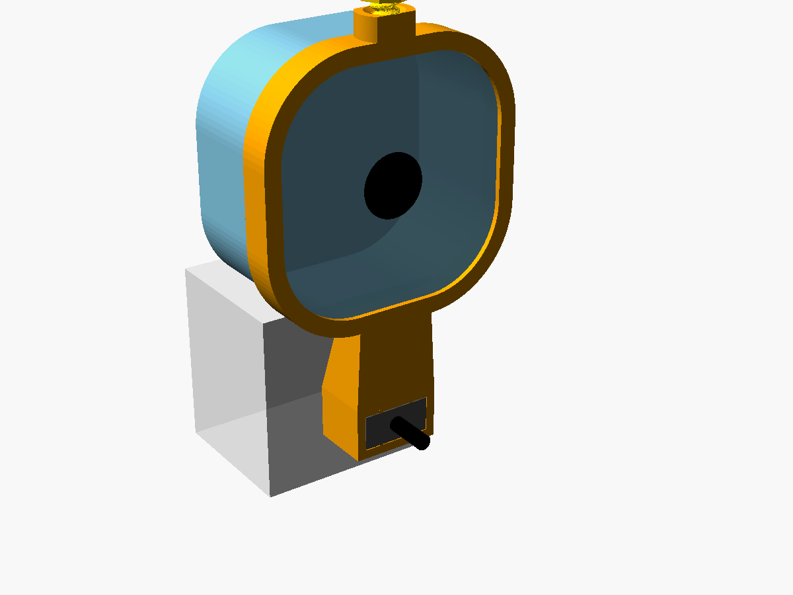

# Alfred camera mount

A small one-piece frame that remounts an Alfred security camera (broken base) on its
own power plug. A sleeve slips over the USB-A plug body in the wall wart, and a
narrow rounded-square ring holds the camera directly above it, face vertical, looking
straight out from the wall. The frame's front face is flush with the outer end of the
USB-A plug.



## Parts

| File | Print | Notes |
|---|---|---|
| `stl/frame.stl` | front face down, as exported | no supports, 9.3 cm³ |
| `stl/screw.stl` | head down, as exported | printed thumbscrew, 6 mm coarse thread |
| `stl/screw_thin.stl` | head down, as exported | 0.15 mm smaller per side, if `screw.stl` binds |

## Assembly

1. Push the camera into the ring from behind until its face stops against the front lip.
2. Turn the thumbscrew down through the top boss until it clamps the camera.
3. Slide the sleeve over the USB-A plug body, wide side horizontal, and plug it into the
   wall wart. The plug's cable comes out under the camera; loop it back to the camera's
   power port.

## Fit parameters

All in the top block of `alfred_camera_mount.scad`:

- `usb_fit` (0.15): per-side clearance on the plug body.
- `rib_h` (0.35): how far the four retention ribs stand into the sleeve. Grip is `rib_h - usb_fit`.
- `lift` (20): height of the camera ring above the sleeve, to clear the wall wart.
- `cam_fit` (0.25): per-side clearance on the camera's sides.
- `scr_clear` (0.40): radial clearance in the threaded hole. Raise it if the screw binds.

Measured inputs: camera front 56.05 mm square, 63.5 mm diagonal (so about 19.0 mm
corner radius); USB-A body 15.72 × 7.81 × 17.66 mm.

## Rebuilding the STLs

```bash
openscad --backend=manifold --export-format=binstl -o stl/frame.stl -D 'part="frame"' alfred_camera_mount.scad
openscad --backend=manifold --export-format=binstl -o stl/screw.stl -D 'part="screw"' alfred_camera_mount.scad
openscad --backend=manifold --export-format=binstl -o stl/screw_thin.stl -D 'part="screw_thin"' alfred_camera_mount.scad
```
