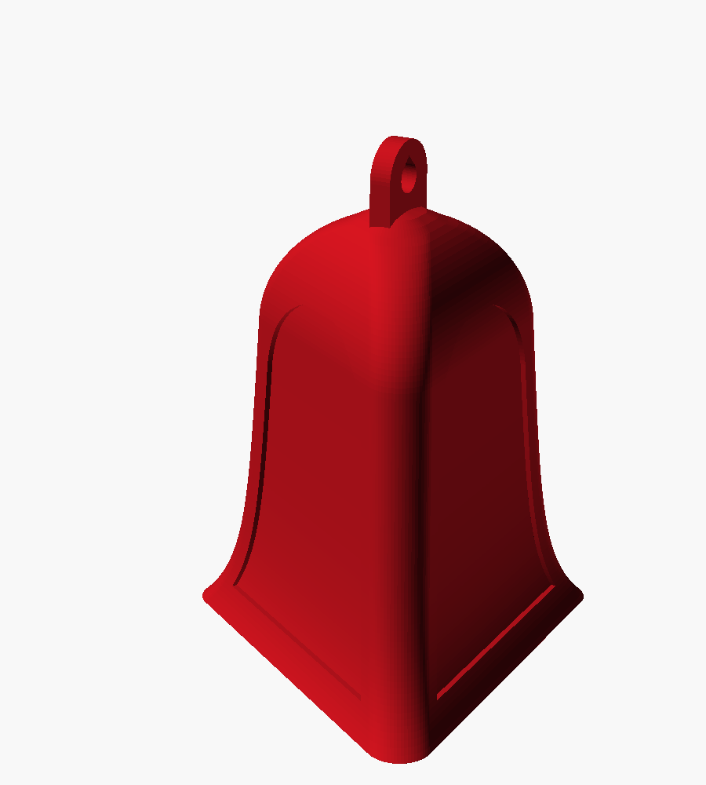

# Bell photo ornament

A three-sided Christmas bell ornament. Each side has a shallow bell-shaped recess for a
photo. The cross-section is a rounded triangle, so each face is flat side to side and
curves only top to bottom. A paper photo bends onto it without wrinkling. Print it,
spray paint it red, and glue the photos in.



| File | Print | Notes |
|---|---|---|
| `stl/bell_photo_ornament.stl` | mouth down, as exported | no supports |
| `docs/photo_template.pdf` / `.svg` | paper, at **100% / actual size** | one photo outline; cut 3 |

Size: 55 × 62 × 80 mm (body 70 mm tall, plus the hanger tab). Each photo is about
39.5 mm wide at the bottom, about 29 mm at the waist, and 51.8 mm tall, with an arched top.

Why it prints without supports: the outside only gets narrower going up. The inside is
a rounded-triangle cavity that never narrows faster than 45°, and it closes in a pyramid
under the dome (see `docs/renders/section.png`). The hole in the hanger tab is a
teardrop, point up. It holds ribbon or a standard ornament hook.

## Finishing

1. Print it with 0.12–0.16 mm layers to keep the layer lines small on the curved faces.
   15% infill is plenty.
2. Optional: give it a coat of filler primer and sand lightly. Spray paint shows every
   layer line.
3. Spray paint red, in several light coats. Paint the pockets too. The photos go on top
   of the paint, and the pocket edges hide the paper's cut edge.
4. Print the photo template at 100% and check it against the ruler size (it is 40 mm
   wide). Trace it onto each photo, or put the photo behind it against a window. Cut
   the photos out.
5. Glue the photos in with a thin layer of glue stick, Mod Podge, or spray adhesive.
   Wet glues cockle photo paper. Press each photo from the middle outward so it follows
   the face's curve.

## Fit parameters

In the top block of `bell_photo_ornament.scad`:

- `pocket_d` (0.8): pocket depth. Photo paper is about 0.25 mm thick, so the photo
  sits a little below the frame.
- `template_fit` (0.3): the template is this much smaller per side than the pocket.
  Raise it if the photos are tight. Lower it if they leave a gap.
- `H`, `r_lip`, `r_waist`, `flare_k`, `dome_z`, `corner`: the bell's shape and size.
  The template follows automatically.
- `pocket_edge`, `pocket_top`, `arch_h`: the frame around each photo, and the photo's
  arch.
- `tab_*`, `hole_d`: the hanger.

## Rebuilding

```sh
openscad -o stl/bell_photo_ornament.stl bell_photo_ornament.scad
openscad -o docs/photo_template.pdf -D 'part="template"' bell_photo_ornament.scad
openscad -o docs/photo_template.svg -D 'part="template"' bell_photo_ornament.scad
```
