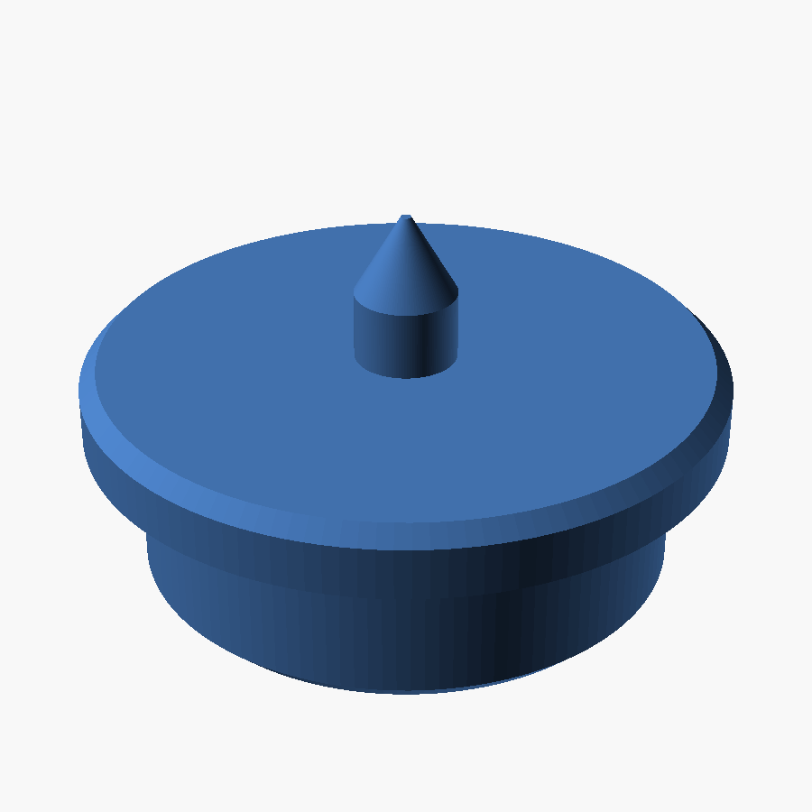

# 5/8" transfer punch

A short transfer punch for a shallow 5/8" hole. The body drops 3/16" into the hole, a lip
stops it on the surface, and a point on the axis marks the mating part pressed onto it.
Print two.



| File | Print | Notes |
|---|---|---|
| `stl/transfer_punch.stl` | body down, as exported | no supports; print 2 |

Dimensions: body Ø15.68 mm × 4.76 mm (3/16"), lip Ø18.9 mm × 2 mm, point Ø3 mm rising
4.3 mm above the lip with a 60° tip.

## Fit parameters

In the top block of `transfer_punch.scad`:

- `fit` (0.10): per-side clearance on the body in the 5/8" hole.
- `hole_dep` (3/16"): body length under the lip.
- `lip_over`, `lip_t`: lip size.
- `pin_d`, `pin_h`, `tip_ang`: the point.

## Rebuilding the STL

```sh
openscad -o stl/transfer_punch.stl transfer_punch.scad
```
